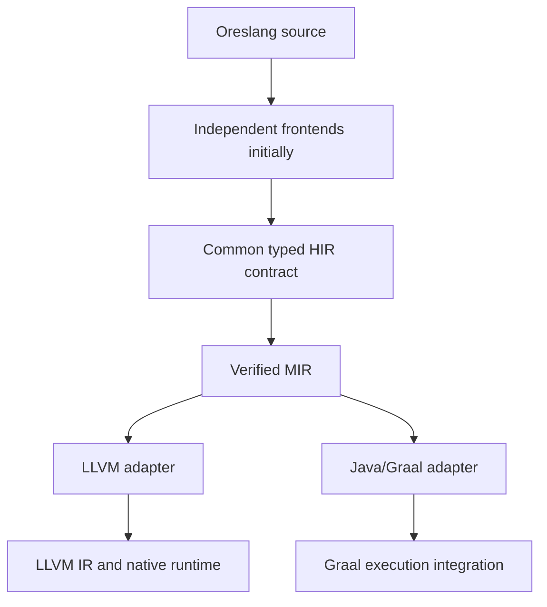

# Oreslang common source

**Status: future architecture and planning only. No shared compiler implementation exists in this repository yet.**

This repository is the intended home for Oreslang's future common semantic compiler layer: **HIR → MIR**, before backend-specific lowering to LLVM and Java/Graal.

For now, the existing implementations remain separate:

| Repository | Responsibility today and during migration |
| --- | --- |
| [oreslang-source.java](https://github.com/ores-truffle-oreslang/oreslang-source.java) | Independent Java/Graal compiler and runtime; later consumes the common representation through its own adapter |
| [oreslang-source.llvm](https://github.com/ores-truffle-oreslang/oreslang-source.llvm) | Independent LLVM compiler and native runtime work; later consumes the common representation through its own adapter |
| **oreslang-common-source** | Future shared semantic representations, HIR → MIR transformations, verifiers, and compatibility contracts |

Creating this repository does not merge the other repositories, change their compiler pins, or establish feature parity.

## Core decisions

- Keep **two independent compilers and borrow checkers** for now. Neither backend waits for the other to implement a feature.
- Share the language specification, TypeSpec/JSON Schema contracts, source fixtures and conformance expectations immediately.
- Consolidate semantic compiler source here later, starting with a proven HIR → MIR boundary.
- **Trusted code, shared actors and isolated actors must eventually support complete AOT in LLVM.** Equivalent Java/Graal guest-code AOT is a target to prove.
- Untrusted guest code may be JIT-compiled, interpreted under policy, or optionally AOT-compiled. It does not require AOT.
- Trust, actor isolation and compilation strategy are independent policy dimensions.

## Intended pipeline

HIR means **high-level intermediate representation**. MIR means **mid-level intermediate representation**. These names describe this project's proposed compiler stages; they do not imply compatibility with another compiler's IR.

The common layer should preserve one language contract while allowing different execution strategies. LLVM IR is not the common MIR. Java bytecode, Truffle nodes, and Graal compiler graphs are not interchangeable representations.

The frontend's implementation language and eventual repository placement are not decided. Existing frontends may initially produce the shared HIR independently. The first shared implementation should focus on a small, verifiable HIR → MIR slice.

## Planned scope

- Backend-neutral types, symbols, source locations, and semantic identities.
- Explicit ownership, borrowing, effects, capabilities, and evaluation order.
- Shared semantic normalization and lowering from HIR to MIR.
- IR verification, versioning, reproducible fixtures, and differential conformance.
- Backend capability declarations and clear rejection of unsupported operations.

Backend code generation, machine-specific layout, runtime implementation, GC strategy, scheduling, and platform integration remain separate responsibilities. Their implementations may differ, but any observable language behavior must satisfy the same declared contract.

## Documents

- [Architecture proposal](docs/ARCHITECTURE.md)
- [HIR/MIR representation design sketch](docs/IR-DESIGN.md)
- [Compilation, trust and backend policy](docs/COMPILATION-POLICY.md)
- [Shared contracts and conformance](docs/CONFORMANCE.md)
- [Ownership syntax: implicit by-value ownership, no public `owned` keyword](docs/OWNERSHIP_SYNTAX.md)
- [Native I/O naming and execution contract](docs/NATIVE_IO_NAMING.md)
- [Ownership-first, zero-GC native and low-GC Graal performance contract](docs/MEMORY_SAFETY_AND_PERFORMANCE.md)
- [Migration roadmap and acceptance gates](docs/ROADMAP.md)
- [Decisions, non-goals and unresolved choices](docs/DECISIONS.md)

## Decision status

**Agreed direction:** keep Java/Graal and LLVM separate now; use this repository for future shared HIR → MIR work.

**Proposals requiring implementation evidence:** exact IR forms, packaging, frontend consolidation, shared optimizations, and adapter APIs.

No runtime parity, performance improvement, or completed migration is claimed by these documents.
